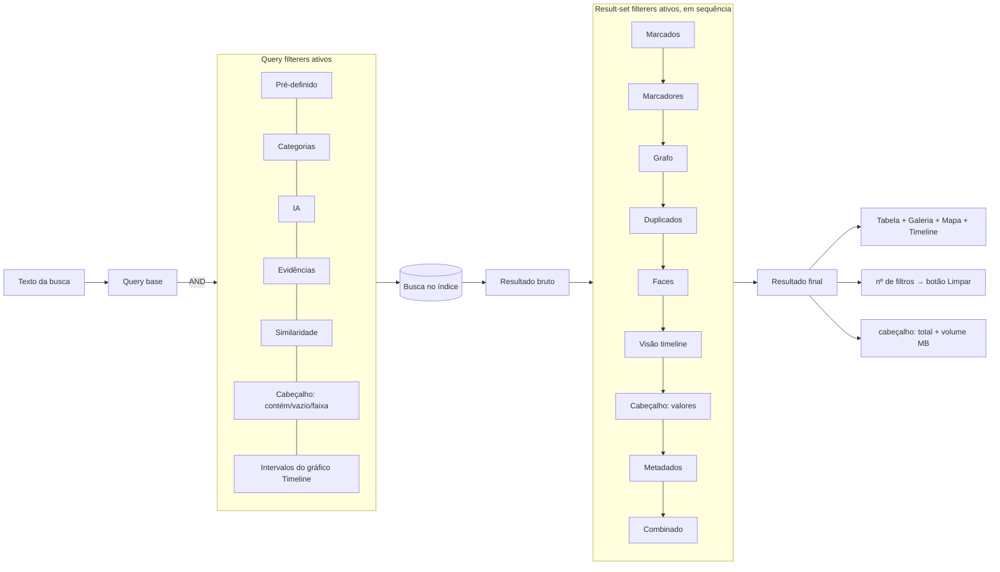
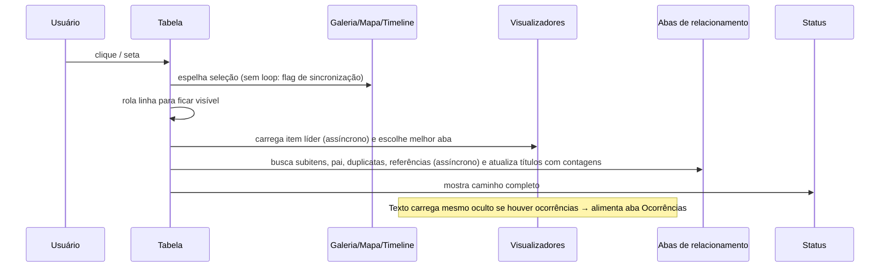

# IPED — Anatomia da Interface de Análise (UI/UX)

> Guia de referência detalhado para **reproduzir, imitar ou adaptar** a interface de análise do IPED em outro aplicativo.
> Baseado na leitura do código-fonte deste repositório (módulos `iped-app`, `iped-viewers`, `iped-geo`) e nos arquivos de
> configuração/tradução (`iped-app/resources`). Os rótulos estão em **pt-BR**, exatamente como aparecem na interface.

---

## Sumário

1. [Visão geral e filosofia de UX](#1-visão-geral-e-filosofia-de-ux)
2. [Glossário de conceitos (essencial)](#2-glossário-de-conceitos-essencial)
3. [Estrutura da janela e layout padrão](#3-estrutura-da-janela-e-layout-padrão)
4. [Barra superior (busca e filtros globais)](#4-barra-superior-busca-e-filtros-globais)
5. [Barra de status](#5-barra-de-status)
6. [Painéis laterais (coluna esquerda)](#6-painéis-laterais-coluna-esquerda)
7. [Área central: visões do conjunto de resultados](#7-área-central-visões-do-conjunto-de-resultados)
8. [Painéis de relacionamento do item (abas inferiores)](#8-painéis-de-relacionamento-do-item-abas-inferiores)
9. [Visualizadores (viewers)](#9-visualizadores-viewers)
10. [O sistema de filtros (coração da UX)](#10-o-sistema-de-filtros-coração-da-ux)
11. [Busca: sintaxe, histórico e destaque](#11-busca-sintaxe-histórico-e-destaque)
12. [Seleção, marcação e marcadores (tags)](#12-seleção-marcação-e-marcadores-tags)
13. [Menu “Opções” / menu de contexto](#13-menu-opções--menu-de-contexto)
14. [Diálogos auxiliares](#14-diálogos-auxiliares)
15. [Atalhos de teclado e mouse](#15-atalhos-de-teclado-e-mouse)
16. [Sincronização entre painéis (fluxos de eventos)](#16-sincronização-entre-painéis-fluxos-de-eventos)
17. [Linguagem visual: temas, cores, ícones, formatos](#17-linguagem-visual-temas-cores-ícones-formatos)
18. [Persistência de preferências](#18-persistência-de-preferências)
19. [Guia de adaptação para outro aplicativo](#19-guia-de-adaptação-para-outro-aplicativo)
20. [Mapa do código-fonte (para consulta)](#20-mapa-do-código-fonte-para-consulta)

---

## 1. Visão geral e filosofia de UX

O IPED é uma ferramenta forense; a interface de análise é um **explorador de um grande índice de itens** (arquivos,
e-mails, mensagens de chat, registros, eventos etc. — até centenas de milhões). A UX gira em torno de **um único conjunto
de resultados** (a "lista atual de itens") que é:

1. **Produzido** pela combinação (E lógico) de *todos* os filtros ativos — busca textual, categorias, árvore de
   evidências, marcadores, metadados, filtros de cabeçalho de coluna, filtros de IA, similaridade, linha do tempo…
2. **Exibido** simultaneamente em várias *visões* sincronizadas — Tabela, Galeria, Mapa, Timeline (gráfico) e Vínculos (grafo).
3. **Inspecionado** item a item: o item *destacado* (selecionado) é carregado nos visualizadores (Hex, Texto, Metadados,
   Pré-visualização) e nos painéis de relacionamento (Ocorrências, Subitens, Item Pai, Duplicatas, Referências, Referenciado por).
4. **Triado**: o analista *marca* itens (checkbox) e os organiza em *marcadores* (tags coloridas) para relatório/exportação.

Princípios observados no código:

| Princípio | Como aparece na UI |
|---|---|
| **Tudo é filtro e todo filtro é visível** | Cada painel que restringe o resultado fica com a **aba vermelha**; o botão "Limpar Filtros" mostra quantos filtros há; o painel **Filtros** lista todos eles. |
| **Contagens em todo lugar** | Categorias `Documentos (1.234)`, marcadores `Relevante (12)`, valores de metadados `PDF (87)`, cabeçalho da 1ª coluna mostra o total de linhas, coluna *tamanho* mostra o volume total `(3.456MB)`, checkbox superior mostra `marcados / total`. |
| **Multisseleção por "toggle"** | Nas árvores de Categorias, Evidências e Marcadores, clicar num nó **adiciona/remove** da seleção (não substitui), sem precisar de Ctrl. |
| **Seleção sincronizada** | Selecionar na Tabela seleciona na Galeria/Mapa/Timeline e vice-versa. |
| **Layout livre** | Todos os painéis são *dockables* (arrastar, empilhar em abas, maximizar, minimizar, destacar em janela). Layout salvável. |
| **Teclado primeiro para triagem** | Espaço marca/desmarca; atalhos personalizáveis por marcador; type-to-find na coluna ordenada. |
| **Operações longas canceláveis** | Busca, ordenação, contagem de colunas e marcações em lote abrem diálogo de progresso com "Cancelar". |
| **Proteção do analista** | Filtros globais de **desfoque** (Ctrl+Q) e **escala de cinza** (Ctrl+W) para imagens sensíveis. |

Capturas oficiais (README do projeto) para referência visual:
[Análise](https://github.com/sepinf-inc/IPED/assets/7276994/5fca2b65-6763-4bc1-9284-604c8b325d54) ·
[Galeria/Carving](https://github.com/sepinf-inc/IPED/assets/7276994/4d908fe5-6cb1-443b-96fa-d937fa1d2e2d) ·
[Regex](https://github.com/sepinf-inc/IPED/assets/7276994/db34adc7-d7b9-4b56-8a35-99e095380d0b) ·
[Mapa](https://github.com/sepinf-inc/IPED/assets/7276994/279b9280-3a72-484a-8aed-e4d015df196f) ·
[Vínculos](https://github.com/sepinf-inc/IPED/assets/7276994/8b164948-fa36-47b8-a249-f64547a36b28) ·
[Faces](https://github.com/sepinf-inc/IPED/assets/7276994/d9b37060-afa4-4e9b-ae55-a9d8413ac43a) ·
[Transcrição](https://github.com/sepinf-inc/IPED/assets/7276994/ebded2ad-f88d-43c8-9699-66e498c9939c) ·
[Timeline (tabela)](https://github.com/sepinf-inc/IPED/assets/7276994/011657e3-8ff2-4105-b3c2-116980772fc0) ·
[Gráfico temporal](https://github.com/sepinf-inc/IPED/assets/7276994/81df1c18-361d-49f1-b755-36520437803a)

Tecnologia original: Java Swing + Look&Feel **Nimbus**, docking com **DockingFrames** (tema *Eclipse* com abas retangulares),
gráficos com **JFreeChart**, mapa com **Leaflet/Google Maps** em WebView JavaFX, busca **Lucene**.

---

## 2. Glossário de conceitos (essencial)

Entender estes termos é pré-requisito para copiar a UX — eles são **três mecanismos distintos** de "seleção":

| Termo (UI) | Significado | Persistência | Representação visual |
|---|---|---|---|
| **Item** | Qualquer objeto indexado (arquivo, e-mail, mensagem, entrada de registro, evento…). | — | Linha da tabela / célula da galeria / marcador no mapa. |
| **Destacado** (*highlighted*) | Item(ns) **selecionados** com o mouse/teclado na tabela/galeria (seleção normal de lista). O item *líder* da seleção é o que aparece nos visualizadores. | Temporária | Linha com fundo de seleção (azul). |
| **Marcado** (*checked*) | Item com o **checkbox** marcado. É uma "cesta" persistente de trabalho, independente da seleção. | Salva no caso | Checkbox na 2ª coluna da tabela, no topo de cada célula da galeria, nos marcadores do mapa. |
| **Marcador** (*bookmark/tag*) | Etiqueta nomeada, com cor, comentário e atalho de teclado opcional. Um item pode ter vários marcadores. | Salva no caso | Coluna "marcador" com *chips* coloridos; ícone colorido na galeria; árvore "Marcadores". |
| **Filtrador** (*filterer*) | Qualquer painel/componente capaz de restringir o conjunto de resultados (Categorias, Evidências, Busca, Cabeçalho da tabela…). | Sessão | Aba vermelha quando ativo; nó no painel **Filtros**. |
| **Filtro** | Uma restrição concreta definida por um filtrador (ex.: categoria "Imagens", `tamanho:[5000 TO *]`). | Sessão | Folha no painel **Filtros**. |
| **Conjunto de resultados** | Lista atual de itens = AND de todos os filtros ativos. | — | Tabela/Galeria/Mapa/Timeline. Total no cabeçalho da 1ª coluna. |
| **Caso / Multicaso** | O índice aberto (pode ser a união de vários casos). | — | Título da janela: `IPED     [Caso: <caminho>]`. |

> Dica de adaptação: mantenha **"destacado" ≠ "marcado" ≠ "marcador"** no seu modelo de dados. Muitas ações do menu
> perguntam "sobre quais itens?" e oferecem as duas origens: *itens destacados* ou *itens marcados*.

---

## 3. Estrutura da janela e layout padrão

### 3.1 Esqueleto da janela

A janela principal (maximizada ao abrir) tem 3 faixas fixas (`BorderLayout`) e uma área central de painéis acopláveis:

```
┌───────────────────────────────────────────────────────────────────────────────────────────────┐
│ Título: "IPED     [Caso: /caminho/do/caso]"                                                     │
├───────────────────────────────────────────────────────────────────────────────────────────────┤
│ BARRA SUPERIOR  (filtro pré-definido · duplicados · limpar filtros · busca · Opções · Ajuda ·  │  PAGE_START
│                  contador de marcados)                                                          │
├───────────────────────────────────────────────────────────────────────────────────────────────┤
│                                                                                               │
│                         ÁREA DE DOCKING (todos os painéis são acopláveis)                     │  CENTER
│                                                                                               │
├───────────────────────────────────────────────────────────────────────────────────────────────┤
│ BARRA DE STATUS: caminho completo do item destacado                                            │  PAGE_END
└───────────────────────────────────────────────────────────────────────────────────────────────┘
```

### 3.2 Layout padrão (horizontal) — wireframe

```
┌──────────────────┬────────────────────────────────────────────────────────────────────────────┐
│[Categorias][Evidências][Filtros]│[Tabela ⏱][Galeria][Mapa][Timeline][Vínculos]                  │
│ ▾ Categorias     │ ┌──────┬─┬─────┬────────────┬──────────────┬────┬──────┬─────────────┬─── │
│   ▸ Documentos   │ │12.345│ │score│marcador    │nome      ▲ ⏷ │ext │tipo  │tamanho (3MB)│ …  │
│     (1.234)      │ ├──────┼─┼─────┼────────────┼──────────────┼────┼──────┼─────────────┼─── │
│   ▸ Multimídia   │ │     1│☑│ 1,0 │[Relevante] │📄 contrato.d…│docx│docx  │     18.432  │    │
│     (20.512)     │ │     2│☐│ 0,8 │            │🖼 foto01.jpg │jpg │jpg   │    245.120  │    │
│   ▸ E-mails e …  │ │   …  │ │     │            │              │    │      │             │    │
│        (20% L)   │ │                        (50% da altura)                                     │
├──────────────────┤ └──────────────────────────────────────────────────────────────────────── │
│[Marcadores][Metadados][IA]      ├──────────────────────────────┬─────────────────────────────┤
│ ▾ Marcadores     │[Ocorrências][Anexos/Subitens][Item Pai]       │[Hex][Texto][Metadados]       │
│   ■ Relevante(12)│[Duplicatas][Referências][Referenciado por]    │[Pré-visualização]  ⌕ ⧉ ◀ ▶ 📌 ▾│
│   ■ Suspeito (3) │  #  │ Ocorrências no conteúdo                 │                             │
│   ■ [Sem Marca-  │  1  │ …pagamento da <propina> ao…             │   (conteúdo renderizado     │
│      dores]      │  2  │ …                                       │    do item destacado)       │
│                  │           (40% da largura)                   │        (60% da largura)     │
├──────────────────┴──────────────────────────────┴───────────────────────────────────────────┤
│ /caso/evidencia.E01/Partição 1/Users/fulano/Documents/contrato.docx                            │
└───────────────────────────────────────────────────────────────────────────────────────────────┘
```

Proporções e pilhas de abas (de `App.adjustLayout()`):

| Região | Posição/tamanho | Abas (na ordem) | Aba ativa ao abrir |
|---|---|---|---|
| Esquerda-superior | Oeste 20% da largura, metade superior | **Categorias** · **Evidências** · **Filtros** | Categorias |
| Esquerda-inferior | Oeste 20%, metade inferior | **Marcadores** · **Metadados** · **IA** | Marcadores |
| Centro-superior | Norte, 50% da altura | **Tabela** · **Galeria** · **Mapa** · **Timeline** · **Vínculos** | Tabela |
| Centro-inferior-esq. | Sul 50%, 40% da largura | **Ocorrências** · **Anexos/Subitens** · **Item Pai** · **Duplicatas** · **Referências** · **Referenciado por** | Ocorrências |
| Centro-inferior-dir. | Sul 50%, 60% da largura | **Hex** · **Texto** · **Metadados** · **Pré-visualização** | Pré-visualização |

### 3.3 Layout alternativo (vertical)

Acionado em *Opções → Layout / Aparência → Alterar Disposição Vertical/Horizontal* (e padrão no modo "triagem"):
Tabela ocupa 70% da altura ao norte; abas de relacionamento 30% ao sul; **visualizadores numa coluna à direita (35% da largura)**.

```
┌────────┬──────────────────────────────────────┬──────────────┐
│Categ.  │ Tabela / Galeria / …  (70% altura)    │              │
│Evid.   │                                      │ Visualizado- │
├────────┤                                      │ res (35% L)  │
│Marcad. ├──────────────────────────────────────┤              │
│Metad.  │ Ocorrências / Subitens / … (30%)      │              │
└────────┴──────────────────────────────────────┴──────────────┘
```

### 3.4 Comportamento dos painéis (docking)

- Cada painel é um *dockable* com **título em aba**. Abas retangulares (estilo Eclipse, compactas para economizar espaço horizontal).
- O usuário pode **arrastar** a aba para outra pilha/borda, **maximizar**, **minimizar** para a borda, ou **destacar** como janela flutuante.
- **Ações na barra de título da aba** (ícones à direita do título — ver cada painel): ex. Tabela tem o botão ⏱ (timeline);
  Galeria tem botões de vídeo, cinza, desfoque, similaridade, +/-; visualizadores têm ◀ ▶ 📌 etc.
- **Aba vermelha** = aquele painel está filtrando o resultado (fundo da aba, da aba focada, da aba selecionada e do botão minimizado ficam vermelhos).
- **Título dinâmico**: algumas abas mostram contagem (`12 Ocorrências`, `3 Anexos/Subitens`, `2 Duplicatas`, `Referências 5`).
- *Layout / Aparência* oferece: **Restaurar Layout Padrão**, **Salvar Layout dos Painéis**, **Carregar Último Layout Salvo**.
- Visualizadores só carregam conteúdo quando sua aba está visível (economia de recursos); ao trocar de aba o conteúdo é carregado sob demanda.

---

## 4. Barra superior (busca e filtros globais)

Ordem exata dos controles, da esquerda para a direita (`BoxLayout` horizontal, borda de 1px):

```
[Sem Filtro ▾] [☐ Filtrar Duplicados Listados] [Limpar Filtros] [🖼×] [👤×]     Pesquisar: [___________________________▾] [Opções] [Atualizar] [Ajuda] [Exportar…ZIP] [☑ 12 / 34.567]
```

| # | Controle | Tipo | Comportamento | Estado visual |
|---|---|---|---|---|
| 1 | **Filtro pré-definido** | Combo (máx. ~100px, 30 linhas visíveis) | Itens: `[Sem Filtro]`, `[Itens Marcados]` e os filtros pré-definidos em ordem alfabética (ver §10.5). Selecionar reexecuta a listagem. Tooltip: "Filtro". | **Fundo vermelho** quando ≠ `[Sem Filtro]`. |
| 2 | **Filtrar Duplicados Listados** | Checkbox | Remove do resultado atual itens com hash repetido (mantém um por hash). Tooltip: "Filtra duplicados em exibição do resultado atual". | **Texto vermelho** quando marcado. |
| 3 | **Limpar Filtro / Limpar Filtros** | Botão | Limpa *todos* os filtradores de uma vez e relista. | Oculto se 0 filtros; "Limpar Filtro" (cores normais) se 1; **"Limpar Filtros" com fundo vermelho e texto branco** se ≥ 2. |
| 4 | **Miniatura da imagem de referência** | Painel com thumbnail | Aparece só durante "Encontrar imagens similares": miniatura com borda vermelha arredondada + "×" à direita. Clique no "×" remove o filtro. Tooltip mostra o nome da imagem de referência. | Oculto por padrão. |
| 5 | **Miniatura da face de referência** | Idem | Idem, para "Encontrar faces similares". | Oculto por padrão. |
| 6 | Rótulo **"Pesquisar:"** | Label | Precedido de espaços (separação visual). | — |
| 7 | **Caixa de busca** | Combo **editável** que estica | Enter executa. Lista suspensa: palavras-chave do caso, depois o divisor `-----------------------Histórico-----------------------`, depois buscas digitadas (mais recentes primeiro). **TAB** autocompleta nomes de propriedades. Placeholder: `[Digite ou escolha a expressão a ser pesquisada. Use [TAB] para autocompletar propriedades.]` (some ao clicar). | **Borda vermelha arredondada de 2px** quando há busca ativa. |
| 8 | **Opções** | Botão | Abre o **menu principal** (o mesmo do clique direito na tabela) logo abaixo do botão. | — |
| 9 | **Atualizar** | Botão | Só existe se a interface foi aberta *durante o processamento*: recarrega dados novos do caso. | — |
| 10 | **Ajuda** | Botão | Abre a página de ajuda (sintaxe de busca) no visualizador. | — |
| 11 | **Exportar itens marcados para ZIP** | Botão | Só no modo triagem. | Oculto por padrão. |
| 12 | **Contador de marcados** | Checkbox com texto `marcados / total` | Clique: se há marcados → confirma "Deseja realmente desmarcar todos os itens?" e desmarca tudo; se não há → marca todos. | Marcado quando há ≥1 item marcado. |

---

## 5. Barra de status

`JLabel` simples na base da janela. Mostra o **caminho completo** do item destacado
(`<pasta do caso>/<caminho interno>`, com `/`). É limpo a cada nova listagem.

---

## 6. Painéis laterais (coluna esquerda)

Todos os painéis desta coluna são **filtradores**: quando têm algo selecionado, sua aba fica vermelha e o resultado
é restringido. A seleção do nó raiz (ou nenhuma seleção) significa "sem filtro".

### 6.1 Categorias

- **Árvore** com raiz "Categorias" visível; cada nó: **ícone da categoria (20px)** + `Nome (contagem)` — contagem
  com separador de milhar; `(...)` enquanto calcula.
- **Seleção por toggle**: clicar num nó o adiciona à seleção; clicar de novo o remove. Várias categorias = **OU** entre elas.
- Expandir/recolher não altera a seleção (proteção contra clique acidental após recolher).
- Hierarquia padrão (resumo, configurável em `CategoriesConfig.json`):

```
Categorias
├─ Documentos ─ RTF · PDF · HTML · Documentos de Texto · Outros Documentos
├─ Arquivos XML · Arquivos de Georeferenciamento · Planilhas · Apresentações · Arquivos OLE
├─ Atalhos ─ Atalhos para Arquivos · Atalhos para URLs
├─ Caixas Postais e Emails ─ Caixas de Emails · Emails · Entradas na Agenda · Anexos …
├─ Multimídia ─ Áudios · Vídeos · Miniaturas de Vídeos · Imagens ─ (Internet temporária · Pastas de sistema · Outras Imagens · Possíveis Digitalizações)
├─ Artefatos do Windows ─ Jump Lists · Arquivos de Eventos · Prefetch e Superfetch · Linha do Tempo do Usuário · Registro do Windows (relatórios por tema) …
├─ Artefatos da Apple · Google Drive · Bases de Dados · Arquivos Compactados · Contatos
├─ Chats ─ WhatsApp · Threema · Messenger · Skype · Telegram · … · Discord · Outros Chats
├─ Programas e Bibliotecas ─ Aplicativos Android
├─ Journal USN · Não Alocado · File Slacks · Textos Simples · Outros Arquivos
├─ Peer-to-peer ─ Ares Galaxy · E-Mule · Shareaza · Torrent …
├─ Vestígios de Navegadores ─ Histórico de Internet · Favoritos Web · Cache do Chrome …
├─ Imagens de Disco ─ Discos ISO · Discos Virtuais · Outros Discos
├─ Programas Brasileiros ─ Receita Federal (IRPF, DIRF, …) · Seguridade Social e CAIXA (SEFIP, GRRF, …)
├─ Resumo da Extração
├─ Chamadas ─ WhatsApp · Telegram · Signal · Chamadas Telefônicas · Outras …
├─ Mensagens SMS · Mensagens MMS
└─ Artefatos de Mensagens Instantâneas
```

### 6.2 Evidências

- Topo: checkbox **"Listagem recursiva de diretórios"** (marcado por padrão).
- Árvore com raiz "Evidências"; mostra **somente pastas e contêineres** (itens com filhos): discos, partições, pastas, ZIPs, PSTs etc.
  Ícones: raiz de evidências, drive, pasta aberta/fechada, ou ícone do tipo do contêiner.
- Selecionar um nó filtra a tabela para:
  - **recursivo ligado** → todos os **descendentes** do nó;
  - **recursivo desligado** → apenas os **filhos diretos** (estilo "explorador de arquivos").
- Seleção por toggle (vários nós = OU). Selecionar um único nó também **abre esse nó nos visualizadores**.
- Menu de contexto: *Exportar árvore de diretórios*, *…(itens marcados)*, *…para ZIP (itens marcados)*.
- É o destino da ação "Navegar para item pai na árvore" (expande o caminho, seleciona o pai e traz a aba para frente).

### 6.3 Filtros (painel de filtros aplicados + filtro combinado)

Painel dividido verticalmente (`JSplitPane`, divisória de 2px, 40% / 60%):

```
┌─ Filtros ───────────────────────────────────┐
│ ☑ Filtro de Palavra-Chave        (fundo rosa)│  ← um nó por filtrador (só tem checkbox quando tem filtro)
│    └ propina AND conta                       │  ← filtros concretos (arrastáveis, cursor "mover")
│ ☑ Filtro de Categorias                       │
│    ├ imagens                                 │
│    └ videos                                  │
│   Filtro de Marcadores                       │
│   Filtro da Árvore de Evidências             │
│ ☑ Filtro de Cabeçalho da Tabela              │
│    └ ext:"pdf"                               │
│   …                                          │
├──────────────────────────────────────────────┤
│ ☐ Filtro Combinado                           │  ← liga/desliga o filtro combinado (fundo rosa quando ligado)
│ ▾ (∩) E                                      │  ← raiz: nó operador
│    ├ ext:"pdf"                               │
│    ├ ¬ (∪) OU                                │  ← "¬" = invertido; ∪ = OU, ∩ = E
│    │   ├ imagens                             │
│    │   └ 🖼 Imagens Similares: foto01.jpg    │  ← filtros com miniatura mostram o thumb 16px
│    └ …                                       │
└──────────────────────────────────────────────┘
```

- **Árvore superior**: lista *todos* os filtradores registrados (nomes como "Filtro Pré-definido", "Filtro de Palavra-Chave",
  "Filtro de Categorias", "Filtro AI", "Filtro da Árvore de Evidências", "Filtro de Imagens Similares", "Filtro de Documentos
  Similares", "Filtro de Cabeçalho da Tabela", "Filtro de Marcadores", "Filtro de Vínculos do Grafo", "Filtro de Duplicados",
  "Filtro de Faces Similares", "Filtro de Visão em Timeline", "Filtro do Painel de Metadados", "Filtro do Gráfico da Timeline", …).
  - Filtrador com filtros mostra **checkbox marcado com fundo rosa** (`#FF9696`); desmarcar **limpa** aquele filtrador.
  - Os filhos são os filtros concretos (texto legível da restrição).
  - Clique direito num filtrador/filtro: **Limpar filtros**, **Ir para item referenciado** (para filtros de similaridade —
    seleciona a imagem/documento de referência na tabela), e um **slider** para filtros quantificáveis (ex.: % de similaridade).
- **Árvore inferior — Filtro Combinado** (construtor booleano visual):
  - Arraste filtros da árvore de cima (ou nós da própria árvore combinada) e solte **sobre** um nó operador.
  - Ícones: interseção (E), união (OU), símbolo de negação à esquerda quando invertido.
  - Clique direito num nó: **Inverter o filtro**, **Trocar para E/OU**, **Adicionar nó E**, **Adicionar nó OU**,
    **Remover o nó**, **Ir para item referenciado**, slider de intensidade.
  - Checkbox **"Filtro Combinado"** (tooltip "Aplicar Filtro Combinado") liga/desliga sua aplicação ao resultado.

### 6.4 Marcadores

- Árvore com raiz **"Marcadores"** e filhos: cada marcador (ícone quadrado arredondado na cor do marcador + `Nome (contagem)`)
  e o nó especial **`[Sem Marcadores]`** (cinza claro), que filtra itens sem nenhum marcador.
- Tooltip do nó = **comentário** do marcador.
- Seleção por toggle; vários marcadores = **união** (itens com qualquer um deles). Raiz selecionada = sem filtro.
- Atalho **Ctrl+B** abre o *Gerenciador de Marcadores* (§14.1).

### 6.5 Metadados (facetas por propriedade)

Painel de "facetas" para explorar a distribuição de valores de **qualquer propriedade** do resultado atual:

```
┌─ Metadados ────────────────────────────────────────────┐
│ Grupo:       [Básicas                              ▾]  │
│ Propriedade: [tipo                                 ▾]  │
│ Filtrar:     [[Propriedades] ↑     ][[Valores] ↓      ]│
│        Ordenação: (○──●)   Escala: (○─●─○)   ⧉ ⟳ ✕     │
├────────────────────────────────────────────────────────┤
│ pdf (1.204)                                            │
│ docx (887)                                             │
│ jpg (20.311)                                           │
│ …                                                      │
└────────────────────────────────────────────────────────┘
```

- **Grupo**: mesmos grupos do Gerenciador de Colunas (Básicas, Base de Hashes, Avançadas, Comuns, Comunicação, Áudio, Imagem,
  Vídeo, PDF, Office, Hipertexto, Regex, Idioma, Entidades Mencionadas, PeerToPeer, UFED, Eventos do Windows, Outras, Todas).
- **Propriedade**: propriedades do grupo (ordem alfabética, sem diferenciar maiúsculas).
- **Filtrar**: dois campos com *hint* — `[Propriedades] ↑` filtra a lista de propriedades do combo acima;
  `[Valores] ↓` filtra a lista de valores abaixo.
- **Ordenação** (mini-slider 2 posições): por contagem / alfanumérica.
- **Escala** (mini-slider 3 posições, só para numéricos): *Sem Intervalos* / *Linear* / *Logarítmica* — agrupa valores em faixas.
- Botões-ícone 20px (*hover button*): **Copiar para a área transf.** (lista de valores), **Atualizar**, **Limpar filtro de metadados**.
- Lista: `valor (contagem)`, altura fixa 18px. **Selecionar valores filtra o resultado** (multisseleção = OU). Quando o
  resultado muda, aparece `[Clique em Atualizar]` para recontar.
- Os valores selecionados também viram **termos de destaque** nos visualizadores.

### 6.6 IA (filtros de classificação automática)

Árvore estilo Categorias, alimentada por `AIFiltersConfig.json`, com ícones próprios e contagens. Nós com contagem 0 ficam
**cinza (desabilitados visualmente)**. Estrutura padrão:

```
IA
├─ Classificador de Imagens Remoto ─ Abuso Sexual Infantil · Possível ASI · Pornografia · Desenho ─(Desenho de ASI · Desenho Explícito) · Pessoas
├─ Detector CSAM ─ Abuso Sexual Infantil · Pornografia · Outro
├─ Faces Detectadas ─ 1 · 2 · 3 ou mais
├─ Faixas Etárias Estimadas ─ Criança · Adolescente · Adulto · Meia-idade · Idoso
├─ Score Nudez ─ Muito Alto (≥900) · Alto (650–899) · Médio (400–649) · Baixo (150–399) · Muito Baixo (<150)
├─ Quantidade de Caracteres OCR ─ Alta (>1000) · Média (100–1000) · Baixa (<100)
├─ Áudios Transcritos
├─ UFED Classificação de Mídia (filhos dinâmicos)
└─ UFED Classificação Nativa de Cena (filhos dinâmicos)
```

Cada nó é um par *propriedade + valor/intervalo* (ex.: `nudityScore:[900 TO *]`). Ótimo padrão para copiar: **facetas
hierárquicas declarativas em JSON**.

---

## 7. Área central: visões do conjunto de resultados

### 7.1 Tabela (visão principal)

**Estrutura das colunas**

| Pos. | Coluna | Detalhes |
|---|---|---|
| 0 | *(sem título)* → **o cabeçalho mostra o total de itens** (ex.: `12.345`) | Número da linha na ordem atual (1-based, com separador de milhar). Largura 55. |
| 1 | *(sem título)* | **Checkbox "marcado"** (editável). Largura 18. |
| 2+ | Colunas de propriedades | Padrão: `score`, `marcador`, `nome`, `ext`, `tipo`, `tamanho`, `deletado`, `categoria`, `criacao`, `modificacao`, `acesso`, `alteracao do registro`, `timeStamp`, `timeEvent`, `hash`, `caminho`. Larguras padrão: 50, 100, 200, 50, 50, 100, 60, 150, 155×6, 250, 2000. |

- Sem linhas de grade; auto-resize desligado (rolagem horizontal); altura de linha = tamanho do ícone (padrão 18px).
- **Nome**: ícone 16–18px por MIME/extensão (pasta, disco para raízes, ícone genérico); termos da busca encontrados no nome
  aparecem **realçados** (fundo amarelo, texto preto).
- **marcador**: desenhado como **chips coloridos** lado a lado (um por marcador, 1px de espaço, cor de texto preto/branco
  automática); se não couber, os nomes mais longos são truncados com `...` progressivamente.
- **Valores múltiplos**: unidos por ` | ` (ordenados), máximo 10 e depois ` ...`.
- **Datas**: `dd/MM/yyyy HH:mm:ss z` em UTC (acesso em FAT: `dd/MM/yyyy`). **Números**: separador de milhar localizado.
- **Categoria**: valores traduzidos.
- **tamanho**: o cabeçalho exibe o volume total listado: `Tamanho (3.456MB)` (`(...)` enquanto calcula).
- Colunas podem ser **reordenadas** (arrastar) e **redimensionadas**; layout salvo por caso e globalmente.

**Cabeçalho com filtro estilo planilha** (componente próprio, vale copiar)

```
┌───────────────────┐  ┌───────────────────┐  ┌───────────────────┐
│ nome          ⏷ ▲ │  │ ext            ⏷  │  │ tipo         ⏷ ▼  │
└───────────────────┘  └───────────────────┘  └───────────────────┘
  ordenado (azulado)     normal (cinza claro)    FILTRADO (vermelho, texto/seta brancos)
```

- Fundo em **gradiente vertical** (claro–escuro–claro) com borda inferior e separador direito em gradiente.
- Estados: **normal**, **ordenado** (tom azulado), **filtrado** (vermelho `#BE0000`→`#F03232`, seta branca), cada um com variante **hover** (+20 de brilho).
- À direita do texto: **ícone de funil (8px)** — presente em todas as colunas exceto nº, checkbox, score e marcador — e **seta de ordenação (6px)** ▲/▼.
- **Clique no texto** → ordena (asc/desc). Ordenação paralela; em grandes volumes mostra "Ordenando..." cancelável.
- **Clique no funil** (ou **clique direito em qualquer ponto do cabeçalho**) → popup de valores:

```
┌──────────────────────────────┐
│ ☐ Vazios                     │
│ ☐ Não vazios                 │
├──────────────────────────────┤
│ [texto para filtrar a lista ]│
│ ☐ docx (887)                 │
│ ☑ pdf (1.204)                │
│ ☑ xlsx (312)                 │
│ …  (rolagem vertical)        │
├──────────────────────────────┤
│      [ Filtrar ] [ Limpar ]  │
└──────────────────────────────┘
largura = largura da coluna (160–1000px), altura 250px
```

  - Lista de **valores distintos com contagem** no resultado atual; filtro de texto incremental (em thread);
    Espaço alterna checkboxes das linhas selecionadas; seleções anteriores por coluna são lembradas.
  - *Vazios / Não vazios* aplicam imediatamente.

**Filtro rápido por valor de célula** — **Ctrl + clique direito** numa célula:

```
┌──────────────────────────────────┐
│ contrato.docx  [⧉]               │ ← valor + botão copiar
├──────────────────────────────────┤
│ Igual a...                       │
│ Iniciam com...        (texto)    │
│ Contém...             (texto)    │
│ Não contém...         (texto)    │
│ Maiores que... / Menores que..   │ (numérico)
│ Depois de... / Antes de...       │ (data)
│ Vazios                           │
│ Não vazios                       │
└──────────────────────────────────┘
```

Para campos multivalorados, cada opção vira um submenu com os valores individuais.

**Interações**

| Ação | Resultado |
|---|---|
| Clique / setas | Destaca item → carrega visualizadores e abas de relacionamento; sincroniza Galeria/Mapa/Timeline; atualiza status. |
| Shift/Ctrl + clique | Multisseleção (destacados). |
| **Duplo clique** | Abre o item no aplicativo externo do SO (pergunta antes se for executável). |
| **Espaço** | Marca/desmarca os destacados (o estado do 1º define o novo valor). |
| Ctrl+R / Alt+R | Marca / desmarca destacados **e seus subitens**. |
| Ctrl+P / Alt+P | … **e o item pai**. |
| Ctrl+F / Alt+F | … **e suas referências**. |
| Ctrl+D / Alt+D | … **e itens que o referenciam**. |
| Ctrl+C | Copia o conteúdo da **célula** selecionada. |
| Digitar letras | **Type-to-find**: salta para a 1ª linha cuja coluna *ordenada* (texto) começa com o texto digitado (buffer de 500 ms; busca binária). |
| Tecla de atalho de marcador | Adiciona os destacados ao marcador; **Alt + mesma tecla** remove (§12.3). |
| Clique direito | Menu "Opções" (§13). |

**Modo Timeline na tabela** — botão ⏱ na barra da aba "Tabela" (tooltip "Alternar Visualização de Timeline na Tabela"):
cada item é **expandido em uma linha por evento temporal** (criação, modificação, acesso, envio…), as colunas `timeStamp` e
`timeEvent` são movidas para a 5ª posição e a tabela é ordenada por `timeStamp` ascendente. O ícone muda para a versão
"ligada" e a ordenação anterior é restaurada ao desligar. Conta como filtro ("Resultado da Visão em Timeline").

**Gerenciamento automático de colunas** — opcional ("Gerenciar colunas automaticamente (mais lento)"): após cada busca
amostra ~50 itens do resultado, **mostra só colunas que têm valor** e traz colunas de comunicação (`message*`,
`communication*`) e UFED para perto do início; as *N primeiras colunas* (padrão 10, configurável 2–12 em
"Fixar Primeiras Colunas...") nunca são removidas.

### 7.2 Galeria

Grade de miniaturas do **mesmo conjunto de resultados**, na mesma ordem da tabela.

```
┌──────────────┬──────────────┬──────────────┐
│☑ ■ foto01.jpg│☐ video.mp4   │☐ doc.pdf     │ ← faixa superior: checkbox + ícone de marcador(es) + nome
│              │              │              │
│   [thumb]    │ [mosaico de  │  [ícone]     │ ← miniatura centralizada, proporção mantida (ampliação máx. 2×)
│              │  quadros]    │ Miniatura não│ ← texto vermelho p/ tipo sem miniatura
│              │              │  suportada   │
└──────────────┴──────────────┴──────────────┘
```

- Sem cabeçalho; espaçamento de 1px; **células quadradas** (altura = largura disponível / nº de colunas).
- **Colunas**: padrão 10, de 1 a 40 (botões −/+ ou *Layout → Alterar Nº Colunas da Galeria*).
- Enquanto carrega, a célula mostra `...`. Vídeos mostram mosaico de quadros.
- Célula selecionada: fundo de seleção + borda de 1px escura; normal: borda clara.
- **Seleção sincronizada** com a tabela (ambos os sentidos); teclado e clique direito são repassados à tabela (mesmos atalhos e menu).
- **Ações na barra da aba "Galeria"**:
  1. *Alternar configuração de cenas para miniaturas de vídeos (Completa / Reduzida)*
  2. *Alternar filtro de cinza na galeria* (Ctrl+W = global)
  3. *Alternar filtro desfocado na galeria* (Ctrl+Q = global)
  4. *Encontrar imagens similares* (habilitado quando o item tem vetor de características)
  5. *Encontrar faces similares*
  6. *Reduzir tamanho das miniaturas* (−) / *Aumentar tamanho das miniaturas* (+)

### 7.3 Mapa

Visão geográfica dos itens georreferenciados **do resultado atual** (Leaflet/OSM ou Google Maps, em WebView).

- Marcadores com 3 estados de ícone: **normal**, **selecionado** (destacado) e **marcado** (checked); agrupamento (*cluster*).
- **Barra lateral recolhível** (botão `+`/`−`) com seções:
  - **Navegação**: Primeiro · Anterior · Próximo · Último (percorre marcadores na ordem da tabela);
  - **Seleção**: por **Área** (arrastar retângulo) e por **Raio** (círculo com distância calculada);
  - **Ordenação**; **Exibir todos** (zoom para caber); **Exportar KML**; **Mudar Servidor de Mapas**;
  - "Itens mapeados" (contador); agrupamento; **mostrar como trilha** (liga pontos em ordem temporal com setas).
- Clique num marcador destaca o item na tabela; marcar/desmarcar no popup sincroniza com o checkbox.
- Seleção por **Área**/**Raio** *destaca* (seleciona) os itens correspondentes na tabela — o mapa não filtra o resultado, apenas o espelha.
- Tema claro/escuro aplicado também ao mapa.

### 7.4 Timeline (gráfico temporal)

Gráfico de **barras empilhadas por período** com a contagem de eventos temporais do resultado atual.

```
┌───────────────────────────────────────────────────────────────┐
│  ▇                                                            │
│  ▇ ▅       ▇▇                                ▃               │  ← barras empilhadas (cor = tipo de evento)
│  ▇ ▅ ▂   ▃ ▇▇ ▂             ▅                ▃ ▂             │     [ ] intervalos definidos (Shift+arrastar)
│──┴─┴─┴───┴─┴┴─┴─────────────┴────────────────┴─┴─────────────│
│ jan/2023        abr/2023        jul/2023        out/2023      │  ← eixo de datas (granularidade ajustável)
├───────────────────────────────────────────────────────────────┤
│ ■ criacao  ■ modificacao  ■ acesso  ■ envio  ■ …              │  ← legenda em lista com quebra (multisseleção)
└───────────────────────────────────────────────────────────────┘
```

- Pode ser **separado em vários gráficos** (um por marcador ou por categoria selecionada) — menu do eixo: *Não separar
  gráfico* / *Separar gráfico por marcador* (/ categoria / metadado).
- **Mouse**: arrastar = **zoom** no período; **Ctrl+arrastar** = **pan**; **Shift+arrastar** = **define intervalo de filtro**
  (vários intervalos permitidos, alinhados à granularidade); roda = zoom (Shift = só eixo X; Ctrl = só eixo Y);
  zoom acelera com rolagem rápida.
- **Clique direito** (menus contextuais por região):
  - *Área do gráfico*: ☐ Aplicar filtros definidos · Limpar filtros · Abrir formulário de definição de intervalos ·
    ☐ Sincroniza destacamento no gráfico de linha do tempo · Resetar Zoom.
  - *Ponto da área de plotagem*: Filtrar anteriores a `<data>` · Destacar anteriores a · Filtrar posteriores a · Destacar posteriores a.
  - *Barra (item de dado)*: Destacar itens do evento no período · Destacar itens do período · Marcar itens do evento no período · Marcar itens do período.
  - *Intervalo definido*: Filtrar os intervalos definidos · Destacar itens neste intervalo · Excluir intervalo · Continuar seleção de intervalos...
  - *Legenda*: Esconder no gráfico · Mostrar · Excluir do conjunto de resultados (filtrar) · Reincluir no conjunto de resultados ·
    Selecionar/Deselecionar todos os eventos · Marcar/Desmarcar os itens dos eventos selecionados.
  - *Eixo de tempo*: **Granularidade da periodicidade** (Ano, Trimestre, Mês, Semana, Dia, Hora, Minuto, Segundo) · **Time Zone** (submenus por região).
- Diálogo **"Intervalos definidos no gráfico"** para editar datas/horas exatas dos intervalos.
- Mensagens de proteção: se o período visível for grande demais para a granularidade, pergunta se deve dar zoom; ao atingir o
  limite de zoom, oferece trocar de granularidade automaticamente.
- Enquanto calcula, mostra um GIF "carregando" centralizado.

### 7.5 Vínculos (grafo de comunicações)

Grafo de entidades (pessoas, telefones, e-mails, contas…) e ligações (chamadas, mensagens, e-mails).

- **Barra de ferramentas**: Desfazer Ação · Refazer Ação · Ajustar à tela · Salvar Imagem · Buscar Entidades Vinculadas ·
  Exportar Vínculos · Busca Avançada.
- **Menu do nó**: Expandir · Expandir (Filtro) · Encontrar conexões · Encontrar caminhos · Remover · Mostrar no Visualizador.
- **Painel lateral**: tabela *Propriedade / Valor* do nó selecionado + miniatura do grafo.
- Grafo inicial inclui apenas as entidades mais conectadas ("Grafo inicial pronto…").
- Selecionar arestas filtra a tabela para os itens de comunicação correspondentes ("Filtro de Vínculos do Grafo").
- Item da tabela com remetente/destinatário → menu "Adicionar à análise de vínculos".

---

## 8. Painéis de relacionamento do item (abas inferiores)

Mostram informações **do item destacado** (não do conjunto). São todos tabelas compactas com o mesmo layout:

| Coluna | Conteúdo |
|---|---|
| `#` | Nº da linha (largura 40) |
| ☐ | Checkbox marcado (18) — editável, **Espaço** marca em lote |
| ■ | Ícone de marcador(es) |
| nome | Nome com ícone do tipo |

| Aba | Conteúdo | Título dinâmico |
|---|---|---|
| **Ocorrências** | Tabela `#` / **Ocorrências no conteúdo**: fragmentos de texto com o termo realçado. Clicar rola o visualizador de Texto até a ocorrência. | `N Ocorrências` |
| **Anexos/Subitens** | Filhos diretos (anexos de e-mail, arquivos dentro de ZIP, mensagens de um chat…). | `N Anexos/Subitens` |
| **Item Pai** | O contêiner do item. | `Item Pai` |
| **Duplicatas** | Outros itens com o mesmo hash (coluna caminho com ícone). | `N Duplicatas` |
| **Referências** | Itens que este item referencia (ex.: mídia citada por uma mensagem). | `Referências N` |
| **Referenciado por** | Itens que referenciam este. | `Referenciado por N` |

Comportamento: **clique** carrega o item nos visualizadores *sem mudar a seleção da tabela principal* (navegação lateral);
**duplo clique** abre externamente. Ao mudar de item, títulos voltam ao padrão e as tabelas são limpas.

---

## 9. Visualizadores (viewers)

Quatro abas (cada uma é um dockable independente):

| Aba | Conteúdo |
|---|---|
| **Hex** | Visualizador hexadecimal completo ("Hex Viewer Plus"): posição/relativo/charset/seleção, busca texto/hex com navegação de ocorrências, ir para posição, selecionar bloco, copiar hex/texto, configurações de cores/layout/fonte/bytes por linha, salvar/carregar perfil. |
| **Texto** | Texto extraído (parser/OCR/transcrição) em tabela de linhas, **fonte monoespaçada 11pt**, termos realçados (amarelo/preto). |
| **Metadados** | 3 seções (abas/tabela HTML): **Propriedades Básicas** (nome, tamanho, ext, tipo, deletado, categoria, criação, modificação, acesso, alteração, hash…), **Propriedades Avançadas**, **Metadados** (todos os campos do parser). |
| **Pré-visualização** | "MultiViewer": escolhe automaticamente o renderizador adequado ao tipo — Imagem, CAD, HTML, E-mail (De/Para/Cc/Bcc/Assunto/Envio/Anexos), MSG, HTML com links (chats renderizados), PDF, TIFF multipágina, Áudio (com transcrição automática), Arquivo referenciado, Office via LibreOffice embutido. |

**Ações na barra de título de cada visualizador** (ícones):

| Ação | Disponível em | Descrição |
|---|---|---|
| ⌕ *Localizar no visualizador* | Pré-visualização | Busca dentro do conteúdo renderizado. |
| ⧉ *Copiar imagem do visualizador* | Pré-visualização | Captura de tela do visualizador para a área de transferência. |
| ◀ *Ocorrência Anterior* / ▶ *Próxima Ocorrência* | Todos | Navega entre termos da busca (habilitado se há ocorrências e o visualizador suporta). |
| 📌 *Fixar Visualizador* | Todos | Impede a troca automática de aba ao mudar de item. |
| ▾/▴ *Mostrar/Ocultar Barra de Ferramentas* | Visualizadores com toolbar | Liga a toolbar interna (ex.: imagem). |

**Barra de ferramentas do visualizador de imagem**: girar esquerda/direita · zoom + / − · ajustar à janela · ajustar à largura ·
brilho (slider) · escala de cinza · desfoque · **mostrar faces detectadas** · filtro de faixa etária (Criança, Adolescente,
Adulto, Meia-idade, Idoso).

**Seleção automática da aba**: ao destacar um item, o controlador escolhe o **melhor visualizador para o tipo** e traz a aba
dele para frente (sem roubar o foco do teclado), a menos que o usuário tenha **fixado** o visualizador. Visualizadores ocultos
não carregam conteúdo (só o de Texto carrega quando há ocorrências, para alimentar a aba Ocorrências).

---

## 10. O sistema de filtros (coração da UX)

### 10.1 Modelo mental

> **Resultado = Busca ∧ Filtrador₁ ∧ Filtrador₂ ∧ … ∧ Filtradorₙ**
> Dentro de um mesmo filtrador, seleções múltiplas normalmente são **OU** (categorias, marcadores, nós de evidência, valores de metadados).
> O **Filtro Combinado** permite montar expressões arbitrárias E/OU/NÃO entre filtros.

Há dois tipos de filtro, e essa distinção é ótima para performance:

| Tipo | Quando é aplicado | Exemplos |
|---|---|---|
| **Query filter** | Convertido em consulta e combinado (AND) **antes** da busca no índice. | Busca textual, filtro pré-definido, categorias, IA, árvore de evidências, imagens/documentos similares, filtros de cabeçalho "contém/vazio/intervalo", intervalos definidos no gráfico da Timeline. |
| **Result-set filter** | Aplicado **depois**, sobre a lista de IDs retornada (bitsets em cache). | Itens marcados, marcadores, duplicados, faces similares, visão timeline (tabela), seleção do grafo, valores do cabeçalho/metadados, filtro combinado. |

### 10.2 Pipeline de uma listagem



Passos de UI em cada nova listagem (`AppListener.updateFileListing`):
1. Rola tabela/galeria para o topo; limpa visualizadores e abas de relacionamento; reseta títulos ("0 Ocorrências"…); limpa status.
2. Guarda a ordenação atual, executa a busca em segundo plano com **diálogo de progresso modal cancelável**.
3. Ao terminar: atualiza total no cabeçalho, reaplica a ordenação, atualiza galeria, recalcula colunas dinâmicas e o volume total,
   atualiza o painel Filtros, recolore abas e o botão "Limpar Filtros".

### 10.3 Sinalização visual de filtros (regra de ouro)

| Onde | Sinal quando há filtro |
|---|---|
| Aba do painel (Categorias, Evidências, Marcadores, Metadados, IA, Vínculos, Tabela, Timeline…) | **Fundo vermelho** |
| Combo de filtro pré-definido | **Fundo vermelho** |
| Caixa de busca | **Borda vermelha de 2px arredondada** |
| "Filtrar Duplicados Listados" | **Texto vermelho** |
| Cabeçalho de coluna | **Gradiente vermelho** + seta branca |
| Painel Filtros | Checkbox marcado com **fundo rosa** |
| Botão "Limpar Filtros" | Aparece; **vermelho** com ≥2 filtros |
| Barra superior | Miniatura com **borda vermelha** para imagem/face de referência |

### 10.4 Limpeza

- **Limpar Filtros** (barra superior): chama `clearFilter()` de todos os filtradores e relista uma vez.
- Cada filtrador pode ser limpo individualmente (desmarcar no painel Filtros, botão ✕ do Metadados, "Limpar" no popup do cabeçalho,
  clicar no × da miniatura de similaridade, desmarcar o botão ⏱ etc.).

### 10.5 Filtros pré-definidos (combo da barra superior)

Definidos em `conf/DefaultFilters.txt` (`Nome = expressão`), editáveis pelo usuário em *Opções → Gerenciar Filtros*:

| Nome na UI | Expressão |
|---|---|
| Possivelmente Produzidos | `modToInternalTimeDiff:[-60 TO 60]` |
| Filtrar Hashes Conhecidos | `*:* -hashDb\:status:known` |
| Alerta de Hash | `hashDb\:status:alert` |
| Alerta de Hash (ASI) | `hashDb\:status:pedo` |
| Alerta PhotoDNA (ASI) | `photoDnaDb\:status:pedo` |
| Arquivos Criptografados | `encrypted:true` |
| Possíveis Cifrados (Entropia) | `compressRatioLZ4:[1,0039 TO *] && (parserException:true || X-Parsed-By:(RawStringParser EmptyParser) || contentType:video) && tamanho:[100000000 TO *]` |
| Erro de Parsing | `parserException:true` |
| Erro de Leitura | `ioError:true` |
| Timeout ao Processar | `timeout:true OR thumbTimeout:true` |
| Itens Ativos | `subitem:false && carved:false && deleted:false -fileFragment:true` |
| Itens Apagados | `deleted:true` |
| Itens Recuperados | `carved:true` |
| Itens Georreferenciados | `common\:geo\:locations:*` |
| Subitens de Conteineres | `subitem:true` |
| Conteineres não Expandidos | `category:("Mailboxes" "Compressed Archives" "ISO disks" "Other disks" "Virtual disks") -hasSubitem:true -fileFragment:true -isRoot:true` |
| Imagens e Vídeos com Possível Nudez | `nudityScore:[500 TO *]` |
| Arquivos com Miniaturas | `hasThumb:true` |
| Arquivos com Faces | `face\_count:[1 TO *]` *(oculto se o recurso não foi usado)* |
| Arquivos com Faces de Crianças | `faceAge\:labels:child` *(idem)* |

Além deles, sempre: **`[Sem Filtro]`** e **`[Itens Marcados]`**. Filtros cujo recurso não existe no caso são ocultados.

### 10.6 Filtros de similaridade

- **Documentos similares**: menu → pede "Porcentual de similaridade (0 a 100)" (padrão 70) → filtro "Documentos Similares (70%): nome".
- **Imagens similares**: *Item destacado* ou *Imagem externa...* → miniatura aparece na barra superior; resultado reordenado por similaridade.
- **Faces similares**: *Item destacado* ou *Face externa...*; diálogo para escolher faces da imagem (clicar para incluir/excluir),
  modo "Todas as faces selecionadas" (E) ou "Pelo menos uma" (OU), **Similaridade mínima (1-100)**.
- Todos expõem **slider** no clique direito do painel Filtros e "Ir para item referenciado".

---

## 11. Busca: sintaxe, histórico e destaque

### 11.1 Sintaxe (Lucene, conforme a Ajuda embutida)

| Exemplo | Significado |
|---|---|
| `suspeito` | Palavra exata (não acha "suspeitos"). |
| `suspeit?` | Um caractere qualquer no lugar de `?`. |
| `suspei*` | Prefixo. |
| `Sicrano~` | Busca aproximada (fuzzy) — útil em OCR. |
| `"Fulano Tal"` | Frase exata. |
| `Fulano Tal` | Qualquer das palavras (OU). |
| `agência AND conta` | Ambas. |
| `propina -pagamento` | Exclusão. |
| `(Fulano Beltrano) && pagamento` | Agrupamento. |
| `"Fulano Tal"~5` | Proximidade (até 5 palavras). |
| `(Fulano Beltrano Tal)@2` | Pelo menos 2 do conjunto. |
| `nome:comprovante` | Busca em propriedade (qualquer coluna, exceto `marcador` e `score`). |
| `tamanho:[5000 TO *]` | Intervalo numérico (`{}` = aberto). |
| `modificacao:[2015-01-31 TO 2015-03-31T12\:59\:59Z]` | Intervalo de datas. |
| `/y(r|o)/` | Expressão regular (intra-termo). |

Não diferencia maiúsculas/minúsculas; recomenda-se usar acentos para o realce funcionar corretamente.

### 11.2 Recursos da caixa de busca

- **Autocompletar com TAB**: completa o último termo com nomes de propriedades (localizados e originais; primeiro por prefixo,
  depois por "contém"), adiciona `:` no final; TABs seguidos **ciclam** as opções, **Shift+TAB** volta. Escapa caracteres especiais.
- **Histórico**: buscas digitadas são gravadas no caso; aparecem abaixo do divisor "Histórico" (mais recente no topo, sem duplicatas).
  *Opções → Limpar expressões pesquisadas* apaga o histórico. Palavras-chave do processamento aparecem acima do divisor.
- **Importar lista de palavras-chave**: executa cada expressão e cria marcadores com os resultados (um marcador por palavra ou um
  único marcador "Resultados de pesquisa por: …"); informa erros de sintaxe.
- **Exportar lista de termos indexados**: gera arquivo com o vocabulário do índice.
- **Realce**: termos da busca + valores selecionados no painel Metadados são realçados no nome (tabela), no Texto, na
  Pré-visualização e listados na aba Ocorrências.
- `*`, `*:*` ou vazio = sem filtro de busca.

---

## 12. Seleção, marcação e marcadores (tags)

### 12.1 Marcação (checkbox)

- Disponível na tabela, galeria, abas de relacionamento e mapa — **sempre sincronizada**.
- Espaço (em lote), atalhos de marcação avançada (Ctrl/Alt + R, P, F, D), clique no checkbox, checkbox global da barra superior.
- Contador global `marcados / total` na barra superior; `[Itens Marcados]` no combo de filtro; ações de exportar/relatório usam "itens marcados".
- Estado salvo automaticamente no caso.

### 12.2 Gerenciador de Marcadores (Ctrl+B)

```
┌─ Marcadores ─────────────────────────────────────────────────────┐
│ Conjunto de dados:                                                │
│ ◉ Itens Destacados (3)          ○ Itens Marcados (12)             │
│ ☐ Incluir duplicatas (hash)                                       │
├──────────────┬────────────────────────────────────────────────────┤
│ [Criar novo] │ [nome do novo marcador_________________________]   │
│ [Atualizar ] │ [comentários do marcador (multilinha)          ]   │
│              │ Digite (ou combine) teclas para definir atalho p/  │
│              │ [Adicionar]. ALT+tecla sempre aciona [Remover].    │
│ [Adicionar ] │ ┌────────────────────────────────────────────────┐ │
│ [Remover   ] │ │ ■ Relevante                         (F1)       │ │
│              │ │ ■ Suspeito                          (Ctrl+2)   │ │
│              │ │ ■ Fotos família                                │ │
│ [Editar    ] │ └────────────────────────────────────────────────┘ │
│ [Apagar    ] │                                                    │
└──────────────┴────────────────────────────────────────────────────┘
```

- **Conjunto de dados**: aplicar ações aos *destacados* ou aos *marcados* (com contadores ao vivo). Opção de incluir duplicatas por hash.
- **Criar novo** (nome até 256 caracteres; impede nomes repetidos) · **Atualizar** (comentário) · **Adicionar**/**Remover** itens dos
  marcadores selecionados (multisseleção na lista) · **Editar** (nome e cor — também com duplo clique) · **Apagar** (com confirmação).
- **Atalho por marcador**: com um marcador selecionado na lista, pressione a tecla/combinação desejada. Depois, na tabela/galeria,
  essa tecla **adiciona** os destacados ao marcador e **Alt + tecla remove**. Bloqueados: Espaço, R/P/F/D, setas, Home/End/PgUp/PgDn,
  Ctrl+A/B/C; Alt não pode compor o atalho. Se houver atalho de tecla simples, o *type-to-find* da tabela é desativado.
- **Carregar/Salvar marcadores** (menu) exporta/importa o estado (marcados + marcadores + histórico) em arquivo.

### 12.3 Cores dos marcadores

- Paleta de **36 cores padrão** (4 fileiras × 9 matizes: escura, saturada, clara, pastel) + 3 cinzas; cor padrão `#B4B4F0`;
  `[Sem Marcadores]` = `#DCDCDC`.
- Cor inicial **determinística pelo hash do nome**, evitando cores já usadas no caso, e **memorizada por nome** entre casos (`~/.iped/bkmclr.dat`).
- Texto sobre a cor: branco para as 18 primeiras (escuras/saturadas), preto para as demais; cores customizadas usam regra de luminância.
- Ícone: **quadrado arredondado** (raio ≈ tamanho/3+2); item com vários marcadores → o quadrado é dividido em **faixas verticais** com cada cor.

Tabela de cores (RGB), útil para copiar:

| Linha | Cores |
|---|---|
| Escuras | `#660006` `#7C3713` `#7F6A10` `#426D36` `#175226` `#1B4772` `#202F5B` `#2E134B` `#4E1141` |
| Saturadas | `#CF000F` `#F27935` `#E6C828` `#87D37C` `#26A65B` `#3498DB` `#446CB3` `#663398` `#831D6D` |
| Claras | `#F06E78` `#FAAA78` `#FAE696` `#B5EBAA` `#78C896` `#8CBEF0` `#8CA0DC` `#B48CDC` `#BE82B4` |
| Pastéis | `#F5CCCF` `#FCE4D7` `#FDF6D9` `#E7F6E5` `#D4EDDE` `#D6EAF8` `#DAE2F0` `#F3EFF8` `#E6D2E2` |
| Cinzas | `#646464` `#C8C8C8` `#DCDCDC` |

---

## 13. Menu "Opções" / menu de contexto

O **mesmo menu** abre pelo botão *Opções* e pelo **clique direito** na tabela/galeria. Itens desabilitados conforme o item destacado.

```
Marcar itens destacados                                   Espaço
Desmarcar itens destacados                                Espaço
Marcação avançada... ▸
    Marcar itens destacados e subitens                    Ctrl+R
    Desmarcar itens destacados e subitens                 Alt+R
    ─────
    Marcar itens destacados e item pai                    Ctrl+P
    Desmarcar itens destacados e item pai                 Alt+P
    ─────
    Marcar itens destacados e referências                 Ctrl+F
    Desmarcar itens destacados e referências              Alt+F
    ─────
    Marcar itens destacados e "referenciado por"          Ctrl+D
    Desmarcar itens destacados e "referenciado por"       Alt+D
─────────────────────────────
Carregar marcadores
Salvar marcadores
Gerenciar Marcadores                                      Ctrl+B
Gerenciar Filtros
Gerenciar Colunas ▸
    Gerenciar Colunas Visíveis
    Fixar Primeiras Colunas...
    Carregar Último Layout Salvo
    Salvar Layout das Colunas
    Resetar Layout das Colunas
─────────────────────────────
Exportar itens... ▸
    Exportar itens destacados
    Exportar itens marcados
    Exportar itens marcados para ZIP
    Exportar árvore de diretórios
    Exportar árvore de diretórios (itens marcados)
    Exportar árvore de diretórios para ZIP (itens marcados)
─────────────────────────────
Exportar propriedades dos itens destacados          (CSV)
Exportar propriedades dos itens marcados            (CSV)
─────────────────────────────
Importar lista de palavras-chave
Limpar expressões pesquisadas
Exportar lista de termos indexados
─────────────────────────────
Alternar Visualização de Timeline na Tabela
Layout / Aparência ▸
    Restaurar Layout Padrão
    Salvar Layout dos Painéis
    Carregar Último Layout Salvo
    Alterar Disposição Vertical/Horizontal
    Alterar Nº Colunas da Galeria                    (spinner 1–40)
    Tema de Cores ▸  ◉ Claro (padrão)  ○ Escuro
    Alterar Zoom da Interface                        (fator decimal ou "auto"; requer reinício)
    Tamanho dos Ícones                               (Categorias / Galeria / Tabela e Outros)
Copiar imagem do visualizador
─────────────────────────────
Navegar para item pai na árvore
Navegar para posição no chat pai                     (só p/ mensagens de chat)
─────────────────────────────
Encontrar documentos similares                       (se o índice guardou vetores de termos)
Encontrar imagens similares ▸   Item destacado | Imagem externa...
Encontrar faces similares ▸     Item destacado | Face externa...
─────────────────────────────
Abrir pré-visualização/relatório externamente
─────────────────────────────
Adicionar à análise de vínculos                      (só p/ comunicações com remetente/destinatário)
─────────────────────────────
Gerar Relatório Indexado
```

Menus de contexto específicos: árvore de Evidências (exportar árvore), painel Filtros (limpar / ir para item / slider),
Filtro Combinado (inverter / trocar operador / adicionar E/OU / remover), cabeçalho da tabela (popup de valores),
célula com Ctrl (filtro por valor), gráfico da Timeline (5 menus — §7.4), nó do grafo (§7.5).

---

## 14. Diálogos auxiliares

### 14.1 Gerenciador de Marcadores
Ver §12.2 (480×480, não modal).

### 14.2 Colunas visíveis (*Gerenciar Colunas Visíveis*)

```
┌─ Colunas visíveis ─────────────────────┐
│ ☑ Gerenciar colunas automaticamente    │
│   (mais lento)                         │
│ Exibir colunas:                        │
│ [Básicas                           ▾]  │  ← grupos (ver §6.5)
│ [[Digite para filtrar]              ]  │
│ ┌────────────────────────────────────┐ │
│ │ ☑ nome                             │ │
│ │ ☑ ext                              │ │
│ │ ☐ id                               │ │
│ │ …  (checkbox desabilitado se a     │ │
│ │     coluna não existe no caso)     │ │
│ └────────────────────────────────────┘ │
└────────────────────────────────────────┘   modal, 400×400, margens 20px
```
O diálogo irmão **"Escolher propriedades"** (usado em *Exportar propriedades…* e nas propriedades do relatório) reutiliza a mesma lista de checkboxes por grupo, com os botões *Marcar apenas visíveis*, *Marcar / Desmarcar tudo* e OK.

### 14.3 Gerenciar Filtros (pré-definidos)

```
┌─ Filtros ────────────────────────────────────────────────────────┐
│ Filtros:                    │ Expressão:                          │
│ ┌─────────────────────────┐ │ ┌─────────────────────────────────┐ │
│ │ Alerta de Hash          │ │ │ hashDb\:status:alert            │ │
│ │ Itens Apagados          │ │ │                                 │ │
│ │ …                       │ │ └─────────────────────────────────┘ │
│ └─────────────────────────┘ │                                     │
│                   [Apagar]  │                    [Salvar] [Criar] │
└─────────────────────────────┴─────────────────────────────────────┘   680×450
```
"Criar" pede o nome; filtros do usuário ficam em `~/.iped/ipedFilters.txt`.

### 14.4 Gerar Relatório Indexado
Tabela de marcadores com colunas `☐ | Marcador | ThumbsOnly` ("Escolha os marcadores para inserir no relatório"), pasta de saída,
"Preencher informações do caso" (Número da Investigação, Requisitante, Número/Data do Laudo, Título, Examinador, Materiais,
Registro/Protocolo…), botão "Propriedades" (escolher colunas), arquivo de palavras-chave opcional, opções "Não exportar anexos de
emails automaticamente", "Não exportar mídias de chats automaticamente", "Adicionar ao relatório já existente"; botão **Gerar**.

### 14.5 Outros
- **Progresso**: diálogo pequeno "Progresso / Pesquisando... / Cancelar" (modal ao toolkit) para buscas, ordenação, colunas, marcação em lote, exportação.
- **Exportação**: escolha de pasta/arquivo, contador "Copiando X de Y", aviso de erro de permissão/espaço; ZIP mostra hash MD5 ao final.
- **Similaridade de faces**: seleção de faces na imagem, modo E/OU, similaridade mínima.
- **Zoom da interface**: entrada textual (`1.5` ou `auto`).
- **Tamanho dos ícones**: 3 controles (Categorias / Galeria / Tabela e Outros). Padrões: 20 / 24 / 18 px.

---

## 15. Atalhos de teclado e mouse

| Atalho | Contexto | Ação |
|---|---|---|
| **Enter** | Caixa de busca | Executa a busca |
| **Tab / Shift+Tab** | Caixa de busca | Autocompleta / cicla nomes de propriedades |
| **Espaço** | Tabela, galeria, abas de relacionamento | Marca/desmarca destacados |
| **Ctrl+R / Alt+R** | Tabela/galeria | Marca/desmarca destacados + subitens |
| **Ctrl+P / Alt+P** | idem | + item pai |
| **Ctrl+F / Alt+F** | idem | + referências |
| **Ctrl+D / Alt+D** | idem | + "referenciado por" |
| **Ctrl+C** | Tabela | Copia célula |
| **Ctrl+A** | Tabela | Seleciona tudo (destaca) |
| **Ctrl+B** | Global | Gerenciador de Marcadores |
| **Ctrl+Q** | Global | Desfoque global (galeria + visualizador) |
| **Ctrl+W** | Global | Escala de cinza global |
| **Tecla(s) do marcador** / **Alt + tecla** | Tabela/galeria | Adiciona / remove do marcador |
| **Letras** | Tabela | Type-to-find na coluna ordenada |
| **Duplo clique** | Tabela/galeria/abas | Abrir externamente |
| **Clique direito** | Tabela/galeria | Menu Opções |
| **Ctrl + clique direito** | Célula da tabela | Filtro por valor |
| **Clique no funil / clique direito no cabeçalho** | Cabeçalho | Popup de filtro por valores |
| **Arrastar / Ctrl+arrastar / Shift+arrastar** | Gráfico Timeline | Zoom / Pan / Definir intervalo |
| **Roda / Shift+roda / Ctrl+roda** | Gráfico Timeline | Zoom X+Y / só X / só Y |

Tooltips aparecem quase instantaneamente (atraso de 10 ms).

---

## 16. Sincronização entre painéis (fluxos de eventos)

### 16.1 Destacar um item



- A seleção da galeria é convertida em intervalos contíguos para a tabela (e vice-versa).
- Clique em item já selecionado reabre-o nos visualizadores (útil após navegar pelas abas de relacionamento).

### 16.2 Mudar um filtro

Qualquer filtrador → `updateFileListing()` → (§10.2) → todas as visões se atualizam; abas recoloridas; painel Filtros redesenhado.

### 16.3 Mudar marcação/marcador

Atualiza contador `marcados/total`, contagens da árvore de Marcadores, chips da coluna marcador, ícones da galeria, checkboxes
em todas as tabelas/mapa e o cache do Filtro Combinado; estado é salvo no caso.

---

## 17. Linguagem visual: temas, cores, ícones, formatos

### 17.1 Temas

Base **Nimbus** (Swing). Dois temas: **Claro (padrão)** e **Escuro**, trocáveis em tempo real (*Layout / Aparência → Tema de Cores*).

| Token | Claro | Escuro |
|---|---|---|
| Base (`nimbusBase`) | `#33628C` (padrão Nimbus) | `#121E31` |
| Fundo de conteúdo (`nimbusLightBackground`) | `#FFFFFF` | `#1D262F` |
| Controles (`control`) | `#D6D9DF` (padrão Nimbus) | `#808080` |
| Seleção (`nimbusSelectionBackground`) | `#39698A` (padrão Nimbus) | `#6482A0` |
| Texto | preto | `#F9F9FA` |
| Texto selecionado na tabela | branco | branco |
| Foco | `#8CBEDC` | `#96B4D2` |
| Barras de progresso (`nimbusOrange`) | `#2F5CB4` | `#2F5CB4` |
| Galeria: fundo / célula / célula selecionada | `#F0F0F2` / `#FFFFFF` / `#B4C8E6` | `#272B2F` / `#1D262F` / `#6482A0` |
| Galeria: borda / borda selecionada / aviso | `#C8C8CA` / `#143250` / vermelho | `#353C43` / `#82A0DC` / `#C86464` |
| Visualizador: fundo / texto / link | padrão | `#1D262F` / branco / `#C8C8FF` |
| Cabeçalho tabela (gradiente) | `#F9F9FB`↔`#D7DAE0` | `#91959A`↔`#7E8082` |
| Cabeçalho ordenado | `#DCE4EC`↔`#B4C6D6` | `#969AA4`↔`#83858C` |
| Cabeçalho filtrado | `#F03232`↔`#BE0000` | idem |
| Seta de ordenação | `#4674A2` | `#28344B` |
| Funil: preenchimento / hover / contorno | branco→`#ACB0B6` / `#4674E8` / `#989CA2` | idem / idem / `#484C52` |
| Ícone expandir árvore | `#646465` (triângulo 7px) | `#D2D2D3` |

**Cores de alerta (independentes de tema)**: vermelho puro `#FF0000` para abas/combos/bordas com filtro; rosa `#FF9696` para filtradores
ativos; realce de termos: **fundo amarelo, texto preto**.

### 17.2 Ícones

- **Categorias**: um PNG por categoria (`ui/cat/<Nome>.png`) — ~120 ícones.
- **Tipos de arquivo**: por MIME (`ui/mime`) e por extensão (`ui/file/<ext>.png`) — centenas.
- **Árvores**: `evidences-root`, `bookmarks-root`, `drive`, `folder-opened`, `folder-closed`.
- **Filtros de IA**: `ui/filter/<prefixo>.<nome>.png` (versões normal/desabilitada/pequena).
- **Toolbar**: `time`/`timeon`, `video`, `gray-scale`, `blur-image`, `find`, `face`, `minus`, `plus`, `search`, `copy`, `prev`, `next`,
  `pin`, `up`/`down`, `refresh`, `clear`, `combination` (OU), `intersection` (E), `negative` (NÃO), `loading.gif`.
- Tamanhos padrão: tabela/árvore 18px · galeria 24px · categorias 20px (ajustáveis). Ícones renderizados com alta qualidade (*QualityIcon*).

### 17.3 Formatos

- Datas: `dd/MM/yyyy HH:mm:ss z`, **UTC**. Números: `#,###.############` localizado (ex.: `1.234.567`). Contagens sempre com separador.
- Idiomas da UI: pt-BR, en, es-AR, de-DE, fr-FR, it-IT (todos os textos em arquivos `.properties`).

---

## 18. Persistência de preferências

| O quê | Onde |
|---|---|
| Layout dos painéis | `~/.iped/PanelsLayout.dat` (+ `PanelsLayoutExt.dat`) |
| Tema escolhido | `~/.iped/theme.dat` |
| Colunas visíveis/larguras/ordem | `<caso>/iped/data/visiblecols.dat` e global `~/.iped/visibleCols[-locale].dat` |
| Filtros pré-definidos do usuário | `~/.iped/ipedFilters[-locale].txt` |
| Cores memorizadas dos marcadores | `~/.iped/bkmclr.dat` |
| Marcados, marcadores, comentários, atalhos, histórico de buscas | Dentro do caso (salvo automaticamente; exportável em "Salvar marcadores") |
| Zoom da UI, tamanho de ícones | Configuração do usuário |

---

## 19. Guia de adaptação para outro aplicativo

### 19.1 O que copiar primeiro (MVP em ordem de valor)

1. **Layout em 5 regiões com docking** (facetas à esquerda, visões no centro, relacionamentos e visualizadores embaixo).
2. **Tabela virtualizada** com coluna de contagem, checkbox, chips de tags, ícone por tipo, realce de termos, colunas configuráveis.
3. **Barra superior** com busca (histórico + autocomplete de campos), filtro pré-definido, botão "Limpar Filtros" contextual, contador de marcados.
4. **Arquitetura de filtradores plugáveis** (§19.3) + **sinalização vermelha** + painel "Filtros".
5. **Cabeçalho com funil** (valores distintos + contagem) e **Ctrl+clique direito** para filtro por valor.
6. Árvores de **Categorias** e **Marcadores** com contagens e seleção por toggle.
7. **Visualizadores com auto-seleção** e abas de relacionamento.
8. Galeria sincronizada; depois Timeline, Mapa, Grafo; por fim Filtro Combinado.

### 19.2 Equivalentes sugeridos (web/desktop moderno)

| Peça do IPED | Alternativas |
|---|---|
| DockingFrames | **dockview**, FlexLayout (React), Golden Layout, rc-dock; Qt: QDockWidget; .NET: AvalonDock |
| JTable + RowSorter paralelo | **TanStack Table + TanStack Virtual**, AG Grid (filtros por coluna prontos), Glide Data Grid |
| JTree com toggle | react-arborist, rc-tree (modo `multiple` + `checkable` desligado, toggle manual) |
| Galeria JTable | grade virtualizada (react-virtuoso `VirtuosoGrid`) com células quadradas |
| JFreeChart timeline | ECharts (barras empilhadas + `dataZoom` + `brush` para intervalos), Plotly, vis-timeline |
| Leaflet em WebView | Leaflet + markercluster (igual), MapLibre GL |
| Grafo | Cytoscape.js, Sigma.js, vis-network |
| Hex viewer | react-hex-editor / componente próprio virtualizado |
| Lucene | Lucene/Elasticsearch/OpenSearch/Tantivy/Meilisearch (sintaxe compatível ajuda a reaproveitar a Ajuda) |
| Nimbus Light/Dark | tokens CSS (§17.1) com `prefers-color-scheme` |

### 19.3 Modelo de dados sugerido (TypeScript)

```ts
// Um "filtrador" = um painel/componente capaz de restringir o resultado.
interface Filterer {
  id: string;                         // "categories", "bookmarks", "tableHeader"...
  name: string;                       // "Filtro de Categorias" (exibido no painel Filtros)
  kind: 'query' | 'resultSet' | 'both';
  hasFilters(): boolean;              // controla aba vermelha / checkbox no painel Filtros
  getDefinedFilters(): Filter[];      // filhos exibidos no painel Filtros (arrastáveis p/ Filtro Combinado)
  toQuery?(): QueryNode | null;       // AND com a busca, executado no backend
  filterResult?(ids: IdSet): IdSet;   // pós-filtro sobre o resultado (bitset)
  clear(): void;                      // usado pelo "Limpar Filtros"
}

interface Filter {
  label: string;                      // ex.: 'ext:"pdf"', 'Imagens Similares: foto01.jpg'
  query?: QueryNode;
  thumb?: string;                     // miniatura (filtros de similaridade)
  refItemId?: string;                 // "Ir para item referenciado"
  quantity?: { value: number; min: number; max: number }; // slider (% similaridade)
}

// Filtro Combinado
type DecisionNode =
  | { type: 'op'; op: 'AND' | 'OR'; inverted: boolean; children: DecisionNode[] }
  | { type: 'filter'; filter: Filter; inverted: boolean };

// Estado global da tela
interface AnalysisState {
  query: string;                      // texto da busca
  presetFilter: string | null;        // combo; '[Itens Marcados]' é um preset especial
  filterersEnabled: Record<string, boolean>;
  result: { ids: string[]; total: number; totalBytes?: number };
  sort: { field: string; dir: 'asc' | 'desc' } | null;
  highlighted: string[];              // seleção (destacados), lead = highlighted[0]
  checked: Set<string>;               // marcados (persistente)
  bookmarks: Record<string, { color: string; comment?: string; hotkey?: string; itemIds: Set<string> }>;
  timelineTableMode: boolean;
  layout: unknown;                    // serialização do docking
}
```

Regras a respeitar ao implementar:
- `result = execute(AND(query, ...enabledQueryFilters)) |> ...enabledResultSetFilters` — sempre recalculado por inteiro, com **cancelamento** da execução anterior.
- `numFilters` (para o botão Limpar) = busca não vazia + preset ≠ "Sem Filtro" + nº de filtradores com filtros.
- Cada filtrador publica `hasFilters()` → a UI recolore sua aba; não espalhe essa lógica por componentes.
- Evite *loops* de sincronização de seleção (flag `syncing` como no IPED).
- Contagens de facetas (categorias, valores de coluna, metadados) devem ser calculadas sobre o **resultado atual** (ou total do caso, no caso das categorias) e exibidas como `Nome (N)`.

### 19.4 Detalhes de UX que fazem diferença (fáceis de esquecer)

- O **cabeçalho da coluna nº** mostra o **total** — economiza uma barra de status.
- O **cabeçalho de tamanho** mostra a **soma em MB** do resultado.
- O botão **Limpar Filtros some** quando não há nada a limpar e **fica vermelho** quando há vários.
- **Seleção por toggle** nas árvores evita Ctrl+clique e permite montar filtros OU rapidamente.
- Proteção contra seleção acidental logo após **recolher** um nó (janela de 100–500 ms).
- **Placeholder** da busca é um item do combo que some ao clicar (instrui sobre TAB).
- **Type-to-find** só na coluna ordenada e só se for texto (busca binária, buffer de 500 ms).
- **Fixar visualizador** (📌) para comparar o mesmo tipo de visão entre itens.
- **Visualizador escolhido automaticamente**, sem roubar o foco do teclado (o analista continua navegando com setas).
- **Atalhos por marcador** com **Alt = remover** — triagem de milhares de itens só com teclado.
- **Desfoque/cinza globais** (Ctrl+Q/Ctrl+W) para conteúdo sensível — pense em equivalentes para o seu domínio.
- Tooltips praticamente instantâneos (10 ms) e com informação útil (comentário do marcador, imagem de referência…).
- Ao mudar a busca, a tabela **mantém a ordenação** escolhida pelo usuário.
- Itens sem miniatura mostram texto **vermelho** explicativo em vez de célula vazia; carregamento mostra `...`.

### 19.5 Checklist de paridade

- [ ] Docking com 5 regiões, abas, maximizar/minimizar/flutuar, salvar/restaurar/resetar layout, alternar vertical/horizontal
- [ ] Barra superior completa (12 controles, estados visuais)
- [ ] Tabela: colunas fixas (nº/checkbox), padrão de 16 colunas, chips de marcador, ícones, realce, multivalor, datas UTC, total no cabeçalho, MB no tamanho
- [ ] Cabeçalho: ordenação, funil, popup de valores com contagem + vazios/não vazios, estado vermelho
- [ ] Ctrl+clique direito: filtro por valor (igual, começa, contém, não contém, >, <, antes, depois, vazio, não vazio)
- [ ] Galeria: grade quadrada 1–40 colunas, checkbox/nome/ícone, sync de seleção, cinza/desfoque, +/−
- [ ] Árvores: Categorias, Evidências (recursivo), Marcadores (+ "Sem Marcadores"), IA — com contagens e toggle
- [ ] Metadados: grupo/propriedade/filtros/ordenação/escala/copiar/atualizar/limpar
- [ ] Painel Filtros + Filtro Combinado (arrastar, E/OU, inverter, remover)
- [ ] Abas de relacionamento com títulos dinâmicos
- [ ] Visualizadores Hex/Texto/Metadados/Pré-visualização, auto-seleção, ◀ ▶ ocorrências, 📌 fixar
- [ ] Busca Lucene, histórico, TAB-autocomplete, importar palavras-chave → marcadores
- [ ] Marcação (Espaço, Ctrl/Alt+R/P/F/D), contador global, Gerenciador de Marcadores com atalhos e cores
- [ ] Modo timeline na tabela; gráfico temporal com zoom/pan/intervalos/menus; mapa; grafo
- [ ] Exportações, relatório, propriedades CSV
- [ ] Temas claro/escuro, tokens de cor, ícones por tipo/categoria, i18n

---

## 20. Mapa do código-fonte (para consulta)

| Assunto | Arquivo |
|---|---|
| Montagem da janela, barra superior, dockables, layout padrão, atalhos globais | `iped-app/src/main/java/iped/app/ui/App.java` |
| Ações da barra superior e fluxo de listagem | `iped-app/src/main/java/iped/app/ui/AppListener.java` |
| Menu Opções / contexto | `iped-app/src/main/java/iped/app/ui/MenuClass.java`, `MenuListener.java` |
| Modelo da tabela e renderização | `ResultTableModel.java`, `TableCellRenderer.java`, `ResultTableListener.java` |
| Cabeçalho com funil e popup de valores | `ui/controls/table/FilterTableHeaderRenderer.java`, `FilterTableHeaderController.java`, `MetadataValueSearchList.java`, `ui/controls/IPEDSearchList.java`, `TableHeaderFilterManager.java` |
| Filtro por valor de célula | `ui/popups/FieldValuePopupMenu.java` |
| Painel Filtros e Filtro Combinado | `FiltersPanel.java`, `FiltersTreeModel.java`, `ui/filterdecisiontree/*`, `ui/filters/FilterTransferHandler.java`, `FiltererMenu.java`, `controls/CheckBoxTreeCellRenderer.java` |
| Gerenciador de filtros pré-definidos | `FilterManager.java`, `iped-app/resources/config/conf/DefaultFilters.txt` |
| Pipeline de busca + filtros | `CaseSearcherFilter.java`, `UICaseSearcherFilter.java`, `UICaseSearchFilterListener.java`, `ClearFilterButton.java` |
| Categorias / Evidências / IA | `CategoryTreeModel.java`, `CategoryTreeListener.java`, `TreeViewModel.java`, `TreeListener.java`, `ui/ai/*`, `conf/CategoriesConfig.json`, `conf/AIFiltersConfig.json` |
| Marcadores | `BookmarksManager.java`, `BookmarksController.java`, `BookmarksTreeListener.java`, `ui/bookmarks/*` |
| Metadados | `MetadataPanel.java`, `app/metadata/*` |
| Galeria | `GalleryModel.java`, `GalleryCellRenderer.java`, `GalleryListener.java`, `GalleryTable.java` |
| Colunas | `ui/columns/ColumnsManager.java`, `ColumnsManagerUI.java` |
| Visualizadores | `ViewerController.java`, `iped-viewers/iped-viewers-impl/src/main/java/iped/viewers/*` |
| Abas de relacionamento | `BaseTableModel.java`, `SubitemTableModel.java`, `ParentTableModel.java`, `DuplicatesTableModel.java`, `ReferencingTableModel.java`, `ReferencedByTableModel.java` |
| Timeline (tabela e gráfico) | `TimelineListener.java`, `iped-app/src/main/java/iped/app/timelinegraph/*` |
| Mapa | `iped-geo/src/main/java/iped/geo/impl/*`, `iped-geo/src/main/resources/iped/geo/{toolbar.html,openstreet/main.html}` |
| Grafo de vínculos | `iped-app/src/main/java/iped/app/graph/*` |
| Temas | `ui/themes/ThemeManager.java`, `LightTheme.java`, `DarkTheme.java` |
| Ícones | `IconManager.java`, `iped-app/src/main/resources/iped/app/ui/{cat,mime,file,filter,tree}` |
| Persistência de layout | `ui/utils/PanelsLayout.java` |
| Textos da UI (pt-BR) | `iped-app/resources/localization/iped-desktop-messages_pt_BR.properties`, `iped-viewer-messages_pt_BR.properties`, `iped-filters_pt_BR.properties`, `iped-ai-filters_pt_BR.properties`, `iped-geo-messages_pt_BR.properties` |
| Ajuda (sintaxe de busca) | `iped-app/resources/root/help/Help_pt-BR.htm` |
